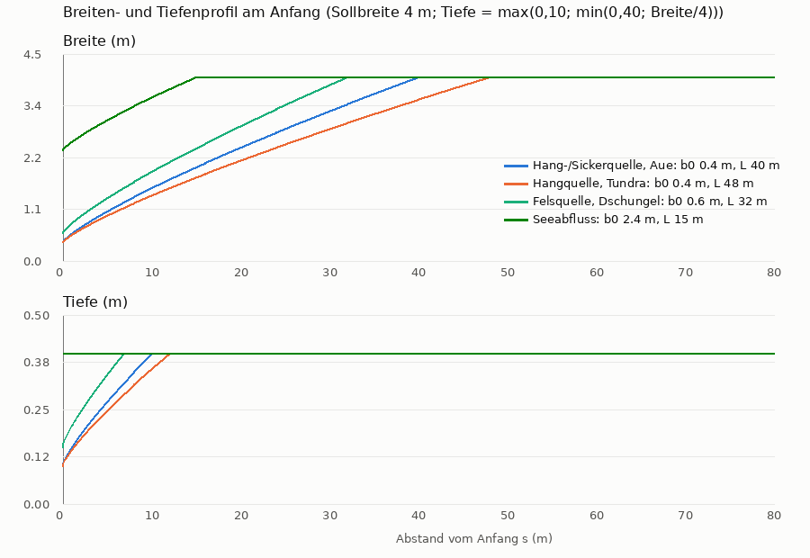
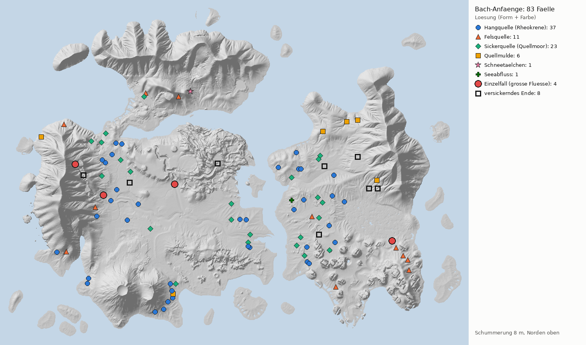
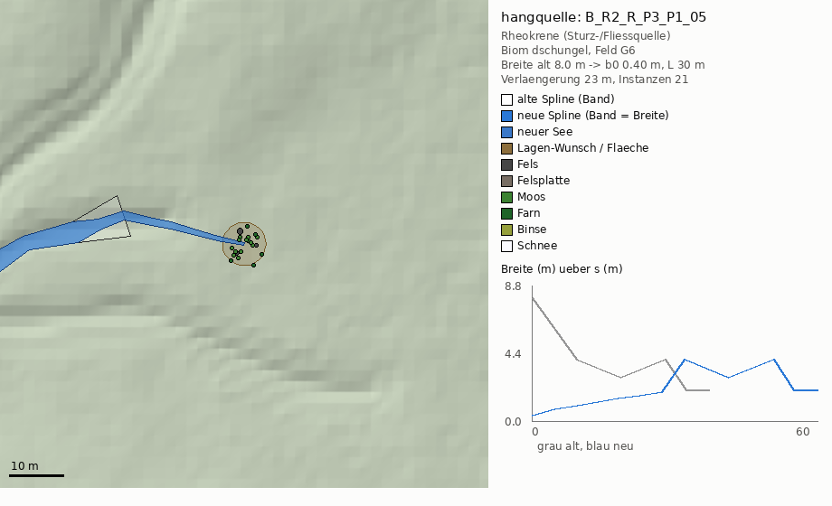
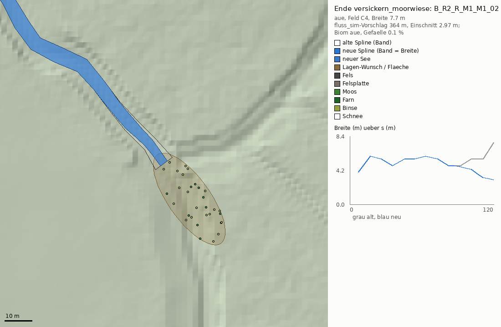

# Antwort Auftrag 19 – Wie beginnt ein Bach? Pläne für 83 Anfänge „aus dem Nichts“, Verjüngung aller Anfänge, 8 Enden, Kaskade K1

Stand 13.10.2026. Bezug: `auftraege/19-bach-anfaenge-quellen.md` (Ferats korrigierte Fassung **652af24**) und die Daten in
`auftraege/daten/bach_anfaenge/` (`bach_anfaenge.md`, `.json`, `.png`).

> **Zahlen:** Der Auftragstext ist an zwei Stellen älter als der Befund. Maßgeblich sind die korrigierten Zahlen:
> **83 Anfänge der Klasse e** (nicht 43) und **8 versickernde Enden** (nicht 59). Mit diesen Zahlen rechne ich durchgehend.

| Ergebnis | Pfad |
|---|---|
| Plan je Fall, Spline-Änderungen, neue Seen, Lagen-Wünsche, Instanzen, Verjüngung aller Anfänge, Neu-Backen-Liste | [`bach_anfaenge/bach_anfaenge_plan.json`](bach_anfaenge/bach_anfaenge_plan.json) |
| Instanzen im Format FORMAT §3 (10 float32 je Instanz + `plan.json`, 28 Felder) | [`bach_anfaenge/instanzen/<Feld>/`](bach_anfaenge/instanzen/) |
| Übersicht, Regel-Profil, eine Skizze je Lösungstyp | [`bach_anfaenge/bilder/`](bach_anfaenge/bilder/) |
| Planer, Regeln, Prüfer | [`skripte/bach_anfaenge/`](skripte/bach_anfaenge/README.md) |

**Kennzeichnung:** [Beleg] Seite gelesen bzw. eindeutig zitierbar · [Suchauszug] nur Suchmaschinen-Auszug, die Seite selbst war aus der
Cloud nicht lesbar · [Ableitung] aus Belegen geschlossen · [Annahme] Gestaltungswert · [Plan] im Skript gerechnet (2-m-Daten).

---

## Kurzfazit

- **Ein Bach beginnt in der Natur nie mit voller Breite.** Er beginnt als Rinnsal von etwa 0,3 m. In Quellgebieten ist das die
  häufigste Breite überhaupt [Suchauszug, Allen et al. 2018: 32 ± 7 cm]. Dann wächst er mit dem Einzugsgebiet. Die Breite steigt etwa mit
  der Wurzel des Abflusses, die Länge mit dem Einzugsgebiet hoch 0,6 [Suchauszug, Leopold & Maddock 1953; Hack 1957]. Daraus folgt
  [Ableitung]: **Breite ≈ s^0,8**, also fast linear und leicht bauchig.
- **Regel für alle Anfänge** (Teil 3, Bild `profil_regel.png`):
  - Breite `b(s) = b0 + (B − b0) · (s/L)^0,8`.
  - Quellbach `b0 = 0,4 m`, Felsquelle 0,6 m, Seeabfluss und Abzweig 0,6 × B, Gletschertor 0,5 × B.
  - Länge `L = 30–60 m` (20 m + 5 m je m Sollbreite, × Biomfaktor 0,8 Dschungel bis 1,3 Canyon). Seeabfluss 15 m, Abzweig 20 m.
  - Tiefe `max(0,10 m; min(Soll; Breite/4))` mit Soll = max(Original; 0,40 m).
  - **Zur 40-cm-Klemme:** Sie soll ab 1,6 m Breite bleiben, darunter mit der Breite sinken. 40 cm Tiefe bei 0,4 m Breite ergeben einen
    Schlitz, den unsere Kasten-Regel ohnehin verbietet (§3).
- **Pläne für alle 83 Fälle** (§2, Tabelle §2.4). Je Fall: neuer Kopf der Spline (`[X, Y, Z, Breite, Tiefe, Tempo]` cm), Quellfassung aus
  natürlichen Felsen, Moos, Farn und Binsen, ein Lagen-Wunsch und ein Water-Brush-Hinweis.

  | Lösung | Fälle | Quelltyp (Thienemann/Steinmann, Bericht 17) |
  |---|---|---|
  | Hangquelle (Anfang 15–25 m den Talweg hinauf verlängern) | **37** | Rheokrene (Fließquelle) |
  | Sickerquelle (Quellmoor, kein Verlängern) | **23** | Helokrene (Sicker-/Sumpfquelle) |
  | Felsquelle (Wasser tritt unter einer Felsplatte aus, im Kalk mit Sinter) | **11** | Schicht-/Karstquelle |
  | Quellmulde (bis in den `mulde_vorschlag` verlängern) | **6** | Rheokrene in Mulde |
  | Schneetälchen (Schneerest über der Quelle) | **1** | Schmelzwasser |
  | Seeabfluss (an See anschließen) | **1** | Seeabfluss |
  | Einzelfälle: Karst-Quelltopf (Canyonbach D4), Quellsumpf-See (Dschungelfluss H5), Karsee (Hauptfluss 1 B4), Kaskade K1 (Hauptfluss 3 C4) | **4** | – |

  53 Anfänge werden verlängert, zusammen 1 051 m. Dazu kommen 1 713 Instanzen in 28 Feldern, 0 Akteure, höchstens 32 je Quelle.
  Felsen kommen aus den Biom-Paletten von `felsgruppen`, Moos und Farn aus den Uferregeln. Kein Mauerwerk, kein Schaum, kein Niagara an Quellen.
- **Die großen Flüsse** (§2.2):
  - **Canyonbach D4:** Karst-Quelltopf am Canyonkopf, 1 592 m², 91 % des Beckens liegen schon unter dem Spiegel. Das Tal darüber
    bleibt ein Trockental, wie über der Fontaine de Vaucluse oder der Loue-Quelle.
  - **Dschungelfluss H5:** Quellsumpf mit Sumpfsee, 4 776 m². Ein Oberlauf ist dort nicht möglich, nördlich fällt das Land auf 2 m.
  - **Hauptfluss 1 B4:** Ein Karsee von 60 × 80 m passt nicht an den Wandfuß, selbst mit 10 m Graben nur 560 m². Machbar ist ein
    Kar-Tümpel von 270 m². Der Stummel wird sein Abfluss und schrumpft auf die Fallbreite 14,9 m (Bericht 17, Rückfrage 3).
- **Kaskade K1** (§2.3) als eigener Punkt:
  - 599 m Schlucht von `F_HAUPTFLUSS_2` (198,4 m) zu `F_HAUPTFLUSS_3_C4` (42,8 m) auf dem Weg des fluss_sim-Vorschlags.
  - 16 m breit, 12 Stufen von 1,3 bis 21,6 m. Nature Water FX nur an den zwei höchsten Fällen.
  - Bis 21 m Einschnitt müssen gegraben werden.
  - Das löst den Anfang von C4 **und** das versickernde Ende von B4.
- **Enden** (§4): 4 werden an den fluss_sim-Vorschlag angeschlossen, 1 ist K1. 2 versickern sichtbar in einer Moorwiese, 1 in einer
  Wüsten-Endpfanne. In feuchten Biomen versickert ein Bach nicht.
- **Neu backen** (§5.3): **149 von 186 Gewässern.**
  - 81 haben einen neuen Anfang, 63 nur eine neue Breite und Tiefe am Anfang.
  - 2 betrifft K1, 3 sind Nachbarn.
  - Jede neue Anfangsbreite ändert `source_size_cm`. Damit wird auch ohne neuen Fingerabdruck neu gebacken.
  - Die vier ersetzten C2-Läufe und Erlenbach p2 fasse ich nicht an. Den Exporter ändere ich nicht.
- **Prüfer:** 0 FEHLER, zwei Läufe byte-gleich (509 Dateien). Die Gegenprobe mit 4 eingebauten Fehlern meldet 4 FEHLER.

---

## 1. Wie beginnt ein Bach – Regeln je Klasse und Biom

### 1.1 Was die Hydrologie sagt

| Aussage | Herkunft |
|---|---|
| Drei Grundtypen nach dem Austritt: **Rheokrene** (Sturz-/Fließquelle: das Wasser bildet sofort einen Bach), **Helokrene** (Sicker-/Sumpfquelle: flächiger Austritt, vernässte Zone mit vielen Rinnsalen), **Limnokrene** (Tümpelquelle: wassergefüllter Quelltopf, selten). Übergänge sind fließend, vor allem zwischen Helo- und Rheokrene. | [Suchauszug] LfU Bayern, Fachbegriffe Quellen; Thienemann/Steinmann |
| Mit zunehmender Hangneigung überwiegt der rheokrene Typ, in Mittelgebirgen und tieferen Lagen die Helokrene (Geissler 1975). | [Suchauszug] Beierkuhnlein & Kleber 1999 |
| Wo ein Gerinne beginnt (Gerinnekopf), hängt von Einzugsfläche **und** Gefälle ab: Je steiler, desto kleiner die nötige Fläche. Gemessen an Hängen von 5 bis 45°. | [Suchauszug] Montgomery & Dietrich 1988, *Nature* 336 |
| Die häufigste benetzte Breite in Quellbach-Netzen ist **32 ± 7 cm**, unabhängig von Abfluss und Landschaft. | [Suchauszug] Allen et al. 2018, *Nat. Commun.* |
| Hydraulische Geometrie flussab: Breite w = a·Q^b mit b ≈ 0,5 (Leopold & Maddock 1953, wie Lacey). Die Tiefe wächst langsamer; den Exponenten (Lehrbuch 0,4) konnte ich nicht nachlesen. | [Suchauszug] USGS PP 252 und USGS-Berichte |
| Hacks Gesetz: Länge ∝ Fläche^~0,6. | [Suchauszug] Hack 1957 |
| Karstquellen treten gebündelt am Fuß einer Wand aus, oft am Kopf eines blinden Tals: Fontaine de Vaucluse unter einer 230-m-Wand, „Vallis Clausa“; Loue-Quelle in einer *Reculée* aus einer Höhle in einer über 100 m hohen Wand. Das Tal darüber kann trocken sein, weil das Wasser unterirdisch fließt. | [Suchauszug] Wikipedia; Montagnes du Jura; Agence de l'eau RMC |
| Gletscherbach: Austritt am Gletschertor, trübes Wasser (Gletschermilch), Maximum Juni bis August und nachmittags. | [Suchauszug] chemie.de (wie Bericht 17 [G1]) |
| Bäche auf Schwemmfächern verlieren Wasser in den Schotter, in trockenen Jahren versickert alles. Auf dem Fächer bleibt ein verzweigtes Bett mit Kiesbänken. | [Suchauszug] USGS PP 1703-K (Trout Creek) |

**Was daraus für uns folgt** [Ableitung]:
1. Jeder Anfang braucht **ein sichtbares Speicher- oder Austrittsmerkmal**: Mulde mit Fels und Moos, Felsplatte, Quellmoor,
   See-Lippe, Schneerest oder Gletschertor. Das ist dieselbe Herkunftsregel wie in Bericht 17 (H1), nur für Bäche statt Fälle.
2. Der Typ folgt dem **Gefälle**: steiler Hang → Rheokrene, flaches Gelände → Helokrene. Fels und Kalk → Fels- bzw. Karstquelle.
3. Die **Breite beginnt bei 0,3–0,4 m** und wächst über einige Zehner Meter auf die Sollbreite. Die Tiefe bleibt am Anfang
   Zentimeter-flach.
4. **Ein großer Fluss** beginnt nur an einem großen Speicher (See, Sumpf, Gletscher) oder an einer **Karstquelle**. Nur dort ist er
   von Anfang an breit.

### 1.2 Regel je Klasse (Befund a–e)

| Klasse | Was am Anfang hin muss | Profil (`bach_anfaenge_regeln.json`) |
|---|---|---|
| **a Seeabfluss** | Lippe aus 2 Blöcken als Widerlager und 2 flachen Steinen, Kies am Austritt. Der See muss höher liegen als der Bach (≥ 5 cm). | b0 = 0,6 · B, L = 15 m |
| **b Fortsetzung, Zusammenfluss, Wasserfall-Fuß** | nichts | unverändert |
| **b Abzweig** | Kies und Steine am Abzweig, Breite ≤ 60 % des Hauptlaufs | b0 = 0,6 · B, L = 20 m |
| **b Lücke** | schließen (fluss_sim-Vorschlag) | – |
| **c Gletscher/Schnee** | Fluss: Gletschertor mit Eis- und Schneefeld über dem ersten Punkt (wie Ferats Vorschlag `F_GLETSCHERTAL_D2`). Bach: Schneetälchen. | Fluss b0 = 0,5 · B; Bach wie d |
| **d Quellmulde** | Quellfassung wie e-Hangquelle, vor allem bei den 26 schwachen Mulden unter 1 m | b0 = 0,4 m, L = 30–60 m |
| **e aus dem Nichts** | Entscheidungsbaum §2.1 | je Typ |

### 1.3 Regel je Biom

| Biom | bevorzugter Quelltyp [Ableitung] | Felsen (felsgruppen `biom_palette`) | Pflanzen | L-Faktor |
|---|---|---|---|---|
| Aue, Heide, Sumpf | Sickerquelle im Flachen, Hangquelle am Talrand | `moos` (MossyForestBoulder, MossyRocks) | Moos, Binsen (ToadRush), Farn (Aue) | 1,0 / 1,1 / 0,8 |
| Bergwald | Hangquelle, an Wänden Felsquelle | `nordisch` | Moos, Farn | 1,0 |
| Elfenwald | Quellmulde, Hangquelle | `moos` | Moos, Farn | 0,9 |
| Dschungel, Canyon (Kalk) | Felsquelle bzw. Karstquelle mit Sinter, Quelltopf | `karst` bzw. `sandstein` | Moos, Farn (Dschungel) | 0,8 / 1,3 |
| Tundra, Gletscher, Frost, Fjord | Schneetälchen am Hang, Quellmoor im Flachen, Gletschertor | `tundra` bzw. `nordisch` | Moos, kein Farn | 1,2 / 1,1 |
| Lava | Hangquelle unter Lavablöcken | `lava` | Moos, kein Farn | 1,0 |

- **Rote Findlinge:** Die `IcelandicBoulder` aus Ferats Werkzeug-Vorschlag stehen nach felsgruppen Runde 3 nur in Canyon, Ödland,
  Wüste und Lava. Ich nehme deshalb die Biom-Paletten.
- **Netze:** Gesperrte, unvollständige und Netze mit Materialbefund fallen weg. Für jede Zielgröße wähle ich ein Netz, dessen Skala
  zwischen 0,4 und 2,5 liegt.

### 1.4 Quellfassung (natürlich, keine Menschenspur)

„Quellfassung“ heißt bei uns: **3–5 Felsen** von 0,6–1,5 m (einer 1,0–1,5 m) im Hufeisen hinter und neben dem Austritt, 35–50 %
eingegraben und auf die Geländenormale gekippt. Dazu **10–14 Moospolster** im Umkreis von 3,5 m und **3–5 Farne** in Waldbiomen. Nasser
Boden ist ein Lagen-Wunsch (Moos 55, Schlamm 25, Erde 20, Radius 4 m). Die Quellmulde formt der Water-Brush (8 × 6 m, 0,5 m tief,
Blend Min). Die anderen Typen:

| Typ | Instanzen | Lagen-Wunsch | Sonstiges |
|---|---|---|---|
| Felsquelle | 1 Felsplatte 2,5–4 m quer zum Hang, 10–20° talwärts gekippt; 2–3 Seitenfelsen; Moos, Farn | Moos 50, Fels 25, Schlamm 25 | Decal `MI_Leakage_03` unter der Platte; in Kalk-Biomen Sinter als Material-Wunsch |
| Sickerquelle | 10–16 Binsen, 8–12 Moos, 1–2 flache Moosplatten in einer Nassfläche 10–14 × 6–8 m hangauf | Moos 45, Schlamm 35, Gras 20 | Bach beginnt 0,4 m breit am unteren Rand |
| Schneetälchen | 1 `Snow_Embankment` 8–14 m hangauf, 3–4 Geröllsteine, Moos | Schnee 70, Geröll 30 (10 × 6 m) | Wasser leicht trüb (Material) |
| Seeabfluss | 2 Blöcke, 2 Platten, 4–6 Moos | Kies 60, Moos 40 | – |

Felsen ab 0,8 m Höhe tragen Kollision (`_kol`). Das sind 33 Stück, alle außerhalb des Wasserbands (Prüfer P5). Alles ist Foliage,
0 Akteure.

### 1.5 Breiten- und Tiefenprofil am Anfang

- **Breite** `b(s) = b0 + (B − b0) · (s/L)^0,8` bis s = L, danach Original. Im Anfangsbereich gilt min(Profil; Original). Damit
  schrumpft die Houdini-Spitze am ersten Punkt (bis 11,3 m) nicht zurück.
- **B** ist die Sollbreite: Median der Original-Breiten zwischen 20 und 120 m. Der erste Punkt ist oft zu breit (8 m statt 2,9 m) und
  zählt deshalb nicht.
- **L** = clamp(Biomfaktor · (20 m + 5 m · B), 30, 60 m). Ab 15 % Gefälle mal 0,8, weil Gerinne am Steilhang früher beginnen
  (Montgomery & Dietrich). Beispiele bei B = 4 m: Aue 40 m, Tundra 48 m, Dschungel 32 m.
- **Tiefe** `max(0,10 m; min(Soll; Breite/4))`. Am Austritt sind das 10 cm, bei 1 m Breite 25 cm, ab 1,6 m Breite die bisherigen 40 cm.
- **Tempo** steigt von 40 cm/s mit (s/L)^0,5 auf den Originalwert. fluss_sim rechnet es ohnehin nach Manning neu (16e).
- **Warum 0,4 m und nicht 0,3 m** [Ableitung]:
  - Die SWR-Zelle ist 0,25 m. 0,4 m sind 1,6 Zellen.
  - Die Wasser-Info-Regel v11 verlangt Pixel ≤ (Bett + 2 m) / 12. Bei 0,4 m sind das 0,20 m je Pixel, eine Zone darf bei 4096 also
    höchstens 819 m groß sein. Heute ist das schmalste Band 2,7 m, das ergibt 921 m.
  - Mit 0,3 m wären es 785 m.

---

## 2. Pläne für die 83 Anfänge

### 2.1 Entscheidungsbaum (`klassifizierung` in den Regeln)

1. **Einzelfall** (4 große Flüsse und Ferats Arm Ost) → §2.2/§2.3.
2. **Seeabfluss:** See ≤ 80 m entfernt, sein Spiegel ≥ 5 cm über dem Anfang, Einschnitt der Verbindung ≤ 2 m. Trifft auf
   `B_R_P2_P0_01` zu (See 48 m, 3,3 m höher).
   - **Verworfen** sind 4 Fälle, Grund jeweils im JSON unter `see_verworfen`.
   - Darunter ist `B_R_P3_P1_03`: Sein See liegt 0,76 m **tiefer** als der Anfang. Ferats Werkzeug schlug dort einen Seeabfluss vor,
     aber das Wasser kann nicht bergauf fließen. Der Fall wird deshalb eine Sickerquelle (Rückfrage 7).
3. **Nebenarm** in der Aue: Fluss ≤ 15 m daneben, höher und breiter. Kein Fall erfüllt das.
4. **Quellmulde:** `mulde_vorschlag` mit 3/4 Seiten steigend, ≤ 50 m entfernt, Steigung ≤ 35 %.
   - 10 Fälle haben so eine Mulde, **6** werden verlängert.
   - Bei 4 ist die Mulde zu steil (42–75 %, z. B. Arm Ost 30 m höher auf 44 m). Dort setze ich eine Fels- bzw. Hangquelle.
5. **Talweg-Spur hangauf:** in 5-m-Schritten im 60°-Kegel die niedrigste höhere Stelle, also die Tiefenlinie. Sie bricht ab, wenn
   das Gelände flach ist oder eine Wand > 45 % kommt. Die Spur wird geglättet, der Spiegel liegt 10 cm unter dem Gelände und fällt
   hangab.
   - **Schneetälchen:** kaltes Biom und ≥ 1 m Anstieg auf 30 m.
   - **Felsquelle:** Kalk-Biom mit ≥ 1,5 m Anstieg, Fels hangauf ≥ 15 % oder eine Wand innerhalb von 25 m. Verlängert wird höchstens
     15 m bis zum Wandfuß.
   - **Hangquelle:** ≥ 1 m Anstieg auf 25 m. Verlängert wird bis 25 m.
   - Sonst **Sickerquelle** ohne Verlängerung.

Skizzen je Typ (alte Spline weiß umrandet, neue Spline blau mit echter Breite, Felsen, Moos, Farn, Binsen, Lagen-Wünsche, rechts die
Breite über s):
[Hangquelle](bach_anfaenge/bilder/skizze_hangquelle.png) ·
[Sickerquelle](bach_anfaenge/bilder/skizze_sickerquelle.png) ·
[Felsquelle](bach_anfaenge/bilder/skizze_felsquelle.png) ·
[Quellmulde](bach_anfaenge/bilder/skizze_quellmulde.png) ·
[Schneetälchen](bach_anfaenge/bilder/skizze_schneetaelchen.png) ·
[Seeabfluss](bach_anfaenge/bilder/skizze_seeabfluss.png) ·
[Karst-Quelltopf](bach_anfaenge/bilder/skizze_karstquelle_trockental.png) ·
[Quellsumpf-See](bach_anfaenge/bilder/skizze_quellsumpf_see.png) ·
[Karsee](bach_anfaenge/bilder/skizze_karsee.png) ·
[Kaskade K1](bach_anfaenge/bilder/skizze_kaskade_k1.png)

### 2.2 Die großen Flüsse: glaubwürdige Herkunft

**`F_CANYONBACH_D4` – Karst-Quelltopf unter einem Trockental** (51 m breit, Canyon, Gefälle 0 %)
- **Befund** [Plan]: Der Canyonboden läuft 150 m weiter nach Norden und steigt dabei um 8 m. Er ist trocken. Am Anfang liegt Trockengras.
- **Herkunft** [Ableitung]:
  - Ein Teich 330 m entfernt mit 12-m-Fall (Vorschlag aus Ferats Werkzeug) ist für einen 51-m-Fluss zu klein, auch mit Spielfaktor 10
    aus Bericht 17.
  - Glaubwürdig ist das Karstbild: Der Fluss tritt in einem **tiefblauen Quelltopf** am Wandfuß aus. Das Tal darüber bleibt **trocken**,
    weil das Wasser unterirdisch fließt (Vaucluse „Vallis Clausa“, Loue-Reculée).
  - Das passt zu Bericht 17, der Canyon als Kalk-Biom mit Karstquelle führt.
- **Plan:**
  - Quelltopf `S_NEU_F_CANYONBACH_D4` als WaterBodyLake, 51 × 40 m, Spiegel 25,75 m. 1 592 m², 91 % liegen schon unter dem Spiegel,
    Abtrag höchstens 0,5 m, bis 2,25 m tief.
  - Der Fluss beginnt am unteren Rand mit 0,8 × B = 34 m und wächst über 90 m auf 43 m.
  - Am oberen Topfrand 6 Sandsteinblöcke (1,8–3,5 m) und 2 Platten, 10 Moos.
  - Ein Nassstreifen-Decal an der Wand.
  - Das **Trockenbett** (Geröll 45, Kies 35, Trockengras 20) läuft als Lagenband 200 m hangauf (40 Punkte).

**`F_DSCHUNGELFLUSS_H5` – Quellsumpf mit Sumpfsee** (49 m breit, Sumpf, flach)
- **Befund** [Plan]: Nördlich fällt das Land auf 2 m. Ein Oberlauf ist dort unmöglich. Der Teich T_3313_789 liegt 5 m tiefer und taugt
  nicht als Quelle.
- **Herkunft** [Ableitung]: Eine Helokrene im Großen. Wasser tritt flächig aus, sammelt sich in einem flachen Sumpfsee, und aus ihm
  fließt der Fluss.
- **Plan:**
  - See `S_NEU_F_DSCHUNGELFLUSS_H5`, Spiegel 6,59 m. Der Umriss folgt dem Gelände: verbunden mit dem Anfang, höchstens 1 m über dem
    Spiegel, nicht flussab, die nächsten 5 400 m².
  - Ergebnis 4 776 m². 61 % liegen schon unter dem Spiegel, Abtrag p90 1,6 m, höchstens 2,8 m.
  - 24 Binsen und 8 Moos am Ufer, Sumpfsaum als Lagen-Polygon (Umriss × 1,3).
  - Der Fluss beginnt mit 0,7 × B = 22 m und wächst über 80 m.
  - Sumpfzypresse und Seerose aus den Downloads vom 11.10. stehen nicht im Inventar. Deshalb nur Binsen.

**`F_HAUPTFLUSS_1_B4` – Kar-Tümpel unter der Karwand** (30-m-Stummel, 21 m breit, über WF_K1)
- **Befund** [Plan]:
  - Darüber steigt eine Rinne steil an, 138 m auf 135 m (Bericht 17, Oberlauf WF_K1).
  - Ein Karsee von 60 × 80 m (Ferats Vorschlag) passt dort nicht. Bei Spiegel 288,2 m sind höchstens folgende Flächen möglich, verbunden
    und nicht flussab:

    | Graben bis | Fläche |
    |---|---|
    | 3 m | 270 m² |
    | 6 m | 394 m² |
    | 10 m | 560 m² |
- **Plan:**
  - Kar-Tümpel `S_NEU_KARSEE_K1` mit 270 m², bis 1,3 m tief.
  - Der Stummel wird sein Abfluss: Breite höchstens **14,9 m** (Fallbreite WF_K1), b0 = 8,9 m über 15 m.
  - 6 Moosblöcke am Ufer, 8 Moos.
  - Die Rinne darüber ist nach Bericht 17 Oberlauf mit Fäden und Nassstreifen (`MI_Leakage`). Wegen ~100 % Steigung kein SWR-Bach.
    Dazu Gipfelnebel.
  - Die Punkte aus 17 stehen im JSON unter `oberlauf_17`.
- **Glaubwürdigkeit:** Sie hängt an Rückfrage 3 aus Bericht 17. Ein 15-m-Vorhang braucht ~30 ha, die Rinne hat 2,6 ha.

### 2.3 `F_HAUPTFLUSS_3_C4` und Kaskade K1 (eigener Punkt)

- **Befund:**
  - `F_HAUPTFLUSS_3_C4` (47 m) beginnt 570 m unter dem Ende von `F_HAUPTFLUSS_2_B4` (198,4 m) und 156 m tiefer.
  - Das Ende von B4 ist eines der 8 versickernden Enden. Beides ist dieselbe Lücke.
- **Weg:** Der fluss_sim-Vorschlag `F_HAUPTFLUSS_2` (`vorschlaege.json`: steilstes Gefälle und geringster Anstieg, 591 m, endet an
  `F_HAUPTFLUSS_3` bei s = 0). Ich übernehme ihn, statt neu zu suchen.
- **Kaskade** [Plan, `kaskade_k1` im JSON, Bild `skizze_kaskade_k1.png`]:
  - Länge und Gefälle: 599 m, 155,6 m Fall. Mittleres Gefälle 26 %.
  - Breite: 40 m Einlauf von 62,7 auf **16 m Schlucht**, 60 m Auslauf auf 47 m.
  - Becken: je 2,5 Schluchtbreiten (40 m) ein Becken mit waagrechtem Spiegel, Tiefe 1,5 m, 60 cm/s.
  - **12 Stufen:** 8,4 · 1,3 · 7,2 · 10,9 · 19,2 · 21,2 · 21,6 · 20,5 · 14,6 · 9,7 · 11,3 · 9,7 m.
  - Lippe 300 cm/s, Fuß 0,5 m danach.
  - 75 Punkte. Der Spiegel fällt nie, der letzte Punkt ist der Anfang von C4.
  - **Einschnitt:** Das Gelände liegt bis 21,3 m über dem Spiegel. 11 Strecken über 3 m sind im JSON aufgelistet. Dort Schlucht graben
    (Stempel/Water-Brush), Felsschalen an die Wände.
  - **Effekte** (gekauftes Nature Water FX, sparsam): nur an den zwei höchsten Fällen (21,6 und 21,2 m) je `NS_Waterfall_Medium`
    an der Lippe und `NS_Impact_Medium` am Fuß, Cull 60 m. Schaum nur dort (Fälle).
- **Spline:** `F_HAUPTFLUSS_2_B4` + K1 (`anhaengen`). `F_HAUPTFLUSS_3_C4` bleibt unverändert und wird zur Fortsetzung. Im Export
  werden `F_HAUPTFLUSS_2` und `_3` ein Gewässer.
- **SWR:** 156 m auf 590 m ergibt nach 16g wohl „kaskade_vorschlag“. Erst im Bild prüfen; Plan B (Kaskadennetz 13g) nur, wenn die
  SWR die Becken nicht hält.
- **Treppen-Design 13f** der Sehens-Bäche bleibt unberührt. K1 ist ein Welt-Fluss. Das Prinzip „Becken und Stufe statt schräges Band“
  ist dasselbe.

### 2.4 Alle 83 Fälle (breite zuerst)

Koordinaten = neuer erster Punkt (bei Einzelfällen der alte). „Verl.“ = Verlängerung hangauf. Die genauen Punkte stehen im JSON unter
`faelle[].spline.punkte` (Modus `kopf_ersetzen`: `punkte + alt[alt_bis_index_exkl:]`).

| # | Gewässer | Feld | Biom | Breite alt m | Lösung | neuer Anfang X / Y m | Verl. m | b0 m | L m | Inst. |
|---|---|---|---|---|---|---|---|---|---|---|
| 1 | `F_CANYONBACH_D4` | D4 | canyon | 51.0 | Karst-Quelltopf | -1157 / -286 | 0 | 34.40 | 90 | 18 |
| 2 | `F_DSCHUNGELFLUSS_H5` | H5 | sumpf | 49.0 | Quellsumpf-See | 3297 / 873 | 0 | 21.70 | 80 | 32 |
| 3 | `F_HAUPTFLUSS_3_C4` | C4 | aue | 47.0 | Kaskade K1 (§2.3) | -2615 / -64 | – | – | – | 0 |
| 4 | `F_HAUPTFLUSS_1_B4` | B4 | bergwald | 21.0 | Karsee | -3190 / -690 | 0 | 8.94 | 15 | 14 |
| 5 | `B_R_P3_P1_03` | G6 | dschungel | 11.3 | Sickerquelle | 1500 / 1180 | 0 | 0.40 | 32 | 25 |
| 6 | `B_R2_R_P3_P1_05` | G6 | dschungel | 8.0 | Hangquelle | 1579 / 1309 | 23 | 0.40 | 30 | 21 |
| 7 | `B_R_M1_M1_01` | C3 | aue | 8.0 | Hangquelle | -2355 / -1113 | 21 | 0.40 | 40 | 18 |
| 8 | `B_R_M2_P0_01` | B5 | bergwald | 8.0 | Felsquelle | -2778 / 190 | 0 | 0.60 | 32 | 14 |
| 9 | `B_R_M2_P1_03` | B6 | bergwald | 8.0 | Hangquelle | -2905 / 1663 | 25 | 0.40 | 40 | 23 |
| 10 | `B_R_P3_P2_01` | G6 | dschungel | 8.0 | Felsquelle | 2149 / 1816 | 13 | 0.60 | 32 | 14 |
| 11 | `B_R2_R_P3_P1_03` | G6 | dschungel | 6.8 | Hangquelle | 1565 / 997 | 19 | 0.40 | 32 | 22 |
| 12 | `B_R_P0_P2_01` | D6 | aue | 6.8 | Sickerquelle | -1134 / 1752 | 0 | 0.40 | 40 | 21 |
| 13 | `B_R_P2_P0_06` | F5 | aue | 6.8 | Sickerquelle | 392 / 750 | 0 | 0.40 | 40 | 26 |
| 14 | `B_R2_R_M1_M1_06` | C4 | aue | 6.0 | Sickerquelle | -2646 / -452 | 0 | 0.40 | 48 | 26 |
| 15 | `B_R2_R_M1_M1_09` | C4 | aue | 6.0 | Sickerquelle | -2256 / -780 | 0 | 0.40 | 40 | 24 |
| 16 | `B_R2_R_P2_P1_02` | F6 | aue | 6.0 | Hangquelle | 388 / 1028 | 20 | 0.40 | 34 | 16 |
| 17 | `B_R2_R_P3_P1_01` | G5 | dschungel | 6.0 | Hangquelle | 2141 / 889 | 22 | 0.40 | 32 | 18 |
| 18 | `B_R2_R_P3_P1_04` | G6 | dschungel | 6.0 | Hangquelle | 1613 / 1321 | 24 | 0.40 | 32 | 20 |
| 19 | `B_R_P1_P0_02` | E5 | aue | 6.0 | Sickerquelle | 2 / 440 | 0 | 0.40 | 40 | 20 |
| 20 | `B_R_P5_P1_04` | I6 | dschungel | 6.0 | Felsquelle | 3629 / 1464 | 14 | 0.60 | 30 | 17 |
| 21 | `B_R2_R_P3_M1_04` | G4 | elfenwald | 5.7 | Sickerquelle | 1820 / -872 | 0 | 0.40 | 31 | 24 |
| 22 | `B_R_M3_M2_03` | A3 | bergwald | 5.7 | Quellmulde | -3881 / -1242 | 8 | 0.40 | 32 | 20 |
| 23 | `B_K8_ELFENFALL_04` | H4 | elfenwald | 4.8 | Quellmulde | 2987 / -366 | 8 | 0.40 | 35 | 17 |
| 24 | `B_R2_R_P1_P0_01` | E5 | aue | 4.8 | Hangquelle | 173 / 444 | 21 | 0.40 | 32 | 18 |
| 25 | `B_R2_R_P3_P1_02` | G6 | dschungel | 4.8 | Sickerquelle | 2016 / 1066 | 0 | 0.40 | 32 | 26 |
| 26 | `B_R_M2_M1_02` | B3 | bergwald | 4.8 | Sickerquelle | -2858 / -1168 | 0 | 0.40 | 44 | 26 |
| 27 | `B_R_M2_M2_01` | B3 | bergwald | 4.8 | Felsquelle | -3427 / -1497 | 13 | 0.60 | 30 | 16 |
| 28 | `B_R_P2_M1_03` | F4 | aue | 4.8 | Sickerquelle | 1240 / -424 | 0 | 0.40 | 40 | 26 |
| 29 | `B_R_P3_M1_05` | G4 | elfenwald | 4.8 | Sickerquelle | 1786 / -796 | 0 | 0.40 | 38 | 22 |
| 30 | `B_R_P3_P0_02` | G4 | heide | 4.8 | Hangquelle | 2088 / -36 | 23 | 0.40 | 44 | 18 |
| 31 | `B_R_P3_P0_03` | G5 | heide | 4.8 | Felsquelle | 1665 / 368 | 12 | 0.60 | 44 | 13 |
| 32 | `B_R_P3_P1_02` | G5 | dschungel | 4.8 | Sickerquelle | 1422 / 802 | 0 | 0.40 | 35 | 25 |
| 33 | `B_R3_R_P3_P0_01` | G5 | heide | 4.5 | Sickerquelle | 1774 / -16 | 0 | 0.40 | 47 | 28 |
| 34 | `B_R3_R_M1_M1_01` | C4 | aue | 4.3 | Hangquelle | -2587 / -703 | 24 | 0.40 | 37 | 20 |
| 35 | `B_R2_R_M1_M1_01` | C3 | aue | 4.0 | Sickerquelle | -2650 / -1138 | 0 | 0.40 | 50 | 26 |
| 36 | `B_R2_R_M1_M1_08` | C4 | aue | 4.0 | Hangquelle | -2423 / -907 | 23 | 0.40 | 40 | 22 |
| 37 | `B_R2_R_M1_P0_05` | C5 | aue | 4.0 | Hangquelle | -2113 / 426 | 24 | 0.40 | 34 | 17 |
| 38 | `B_R2_R_P0_P2_02` | D7 | aue | 4.0 | Hangquelle | -1210 / 2068 | 25 | 0.40 | 30 | 16 |
| 39 | `B_R2_R_P2_M1_01` | F4 | aue | 4.0 | Hangquelle | 985 / -635 | 20 | 0.40 | 34 | 21 |
| 40 | `B_R2_R_P2_P1_01` | F5 | aue | 4.0 | Sickerquelle | 350 / 906 | 0 | 0.40 | 34 | 29 |
| 41 | `B_R2_R_P3_M1_05` | G4 | elfenwald | 4.0 | Hangquelle | 1395 / -605 | 23 | 0.40 | 30 | 18 |
| 42 | `B_R2_R_P3_P0_01` | G5 | heide | 4.0 | Hangquelle | 1498 / 21 | 24 | 0.40 | 44 | 18 |
| 43 | `B_R2_R_P3_P0_03` | G5 | heide | 4.0 | Sickerquelle | 1872 / 94 | 0 | 0.40 | 44 | 26 |
| 44 | `B_R2_R_P3_P0_04` | G5 | heide | 4.0 | Sickerquelle | 1794 / 400 | 0 | 0.40 | 44 | 24 |
| 45 | `B_R3_R_M1_M1_02` | C4 | aue | 4.0 | Sickerquelle | -2060 / -544 | 0 | 0.40 | 36 | 25 |
| 46 | `B_R3_R_M1_P0_01` | C5 | aue | 4.0 | Hangquelle | -1880 / 119 | 22 | 0.40 | 36 | 23 |
| 47 | `B_R_M1_M1_02` | C3 | aue | 4.0 | Hangquelle | -2217 / -1097 | 21 | 0.40 | 40 | 18 |
| 48 | `B_R_M1_M2_01` | C3 | aue | 4.0 | Sickerquelle | -2564 / -1328 | 0 | 0.40 | 30 | 22 |
| 49 | `B_R_M1_P0_02` | C4 | aue | 4.0 | Hangquelle | -2356 / -185 | 23 | 0.40 | 40 | 19 |
| 50 | `B_R_M1_P0_04` | D5 | aue | 4.0 | Sickerquelle | -1652 / 630 | 0 | 0.40 | 40 | 21 |
| 51 | `B_R_M2_P1_01` | B6 | bergwald | 4.0 | Felsquelle | -3374 / 1098 | 0 | 0.60 | 30 | 17 |
| 52 | `B_R_P0_M2_02` | D2 | tundra | 4.0 | Schneetälchen | -841 / -2171 | 18 | 0.40 | 38 | 13 |
| 53 | `B_R_P0_P2_02` | D6 | lava | 4.0 | Hangquelle | -1238 / 1736 | 24 | 0.40 | 30 | 16 |
| 54 | `B_R_P0_P2_04` | D7 | aue | 4.0 | Hangquelle | -1298 / 2149 | 24 | 0.40 | 32 | 21 |
| 55 | `B_R_P0_P2_06` | D7 | aue | 4.0 | Hangquelle | -1579 / 2331 | 25 | 0.40 | 32 | 21 |
| 56 | `B_R_P1_P0_03` | E5 | aue | 4.0 | Hangquelle | 300 / 465 | 23 | 0.40 | 40 | 22 |
| 57 | `B_R_P2_P0_01` | F5 | heide | 4.0 | Seeabfluss | 1238 / 95 | 49 | 2.40 | 15 | 7 |
| 58 | `B_R_P2_P0_02` | F5 | heide | 4.0 | Hangquelle | 1297 / 221 | 21 | 0.40 | 44 | 15 |
| 59 | `B_R_P2_P1_02` | F6 | aue | 4.0 | Hangquelle | 332 / 986 | 22 | 0.40 | 40 | 24 |
| 60 | `B_R_P2_P1_03` | G5 | aue | 4.0 | Sickerquelle | 1344 / 974 | 0 | 0.40 | 40 | 21 |
| 61 | `B_R_P3_M1_09` | G4 | elfenwald | 4.0 | Hangquelle | 2094 / -449 | 23 | 0.40 | 36 | 23 |
| 62 | `B_R_P3_M2_04` | G3 | elfenwald | 4.0 | Quellmulde | 1881 / -1364 | 8 | 0.40 | 30 | 21 |
| 63 | `B_R_P3_P0_04` | G5 | heide | 4.0 | Hangquelle | 2019 / 578 | 20 | 0.40 | 44 | 16 |
| 64 | `B_R_P4_M2_01` | H3 | elfenwald | 4.0 | Quellmulde | 2598 / -1597 | 8 | 0.40 | 30 | 23 |
| 65 | `B_R_P4_M2_02` | H3 | elfenwald | 4.0 | Quellmulde | 2372 / -1569 | 8 | 0.40 | 30 | 21 |
| 66 | `SWR_ARM_OST (C2)` | C2 | tundra | 4.0 | Felsquelle | -1730 / -2147 | 15 | 0.60 | 60 | 12 |
| 67 | `B_R3_R_P5_P1_01` | I6 | dschungel | 3.6 | Felsquelle | 3376 / 1029 | 12 | 0.60 | 34 | 18 |
| 68 | `B_R3_R_P3_P0_02` | G5 | heide | 3.5 | Hangquelle | 2307 / 59 | 21 | 0.40 | 60 | 18 |
| 69 | `B_R3_R_M2_P0_02` | B5 | bergwald | 3.2 | Hangquelle | -2772 / 369 | 24 | 0.40 | 32 | 20 |
| 70 | `B_R3_R_P2_M1_01` | G4 | aue | 3.2 | Hangquelle | 1336 / -910 | 23 | 0.40 | 31 | 22 |
| 71 | `B_R2_R_M1_P0_02` | C5 | aue | 2.8 | Hangquelle | -2471 / 30 | 24 | 0.40 | 30 | 21 |
| 72 | `B_R2_R_P0_P2_01` | D6 | aue | 2.8 | Quellmulde | -1195 / 1966 | 8 | 0.40 | 34 | 19 |
| 73 | `B_R2_R_P5_P1_01` | I6 | dschungel | 2.8 | Felsquelle | 3522 / 1190 | 12 | 0.60 | 30 | 13 |
| 74 | `B_R_P0_P2_03` | D6 | aue | 2.8 | Hangquelle | -1216 / 1875 | 24 | 0.40 | 32 | 16 |
| 75 | `B_R_P1_P0_01` | E5 | aue | 2.8 | Sickerquelle | 2 / 116 | 0 | 0.40 | 40 | 25 |
| 76 | `B_R_P3_M1_08` | G4 | elfenwald | 2.8 | Hangquelle | 1450 / -593 | 23 | 0.40 | 36 | 21 |
| 77 | `B_R_P5_P1_01` | I6 | dschungel | 2.8 | Felsquelle | 3605 / 1275 | 13 | 0.60 | 30 | 17 |
| 78 | `B_R3_R_M2_P2_01` | B6 | aue | 2.7 | Hangquelle | -2919 / 1756 | 22 | 0.40 | 57 | 21 |
| 79 | `B_R2_K10_TUNDRA_01` | C2 | tundra | 2.0 | Sickerquelle | -1776 / -2078 | 0 | 0.40 | 60 | 27 |
| 80 | `B_R2_R_M1_M1_03` | C4 | aue | 2.0 | Hangquelle | -2646 / -768 | 22 | 0.40 | 40 | 21 |
| 81 | `B_R2_R_P0_P2_03` | D7 | aue | 2.0 | Hangquelle | -1396 / 2266 | 18 | 0.40 | 32 | 19 |
| 82 | `B_R_M2_P1_02` | B6 | bergwald | 2.0 | Hangquelle | -3582 / 1098 | 24 | 0.40 | 32 | 22 |
| 83 | `B_R_P0_M2_03` | D2 | tundra | 2.0 | Felsquelle | -1074 / -2080 | 0 | 0.60 | 38 | 11 |

Hinweise:
- **Ferats Arm Ost** (`SWR_ARM_OST (C2)`, Felsquelle): Seine Spline liegt nicht im Repo. Deshalb gibt es dort nur eine Profilvorgabe
  (b0 0,6 m, L 60 m) für `ue_swr_arm.py` und 12 Instanzen, nur im Plan. Unter `instanzen/` steht nichts davon: C2 ist Ferats
  p2-Gebiet.
- `B_R2_K10_TUNDRA_01` (C2) ist **nicht** einer der vier ersetzten Läufe. Er mündet 18 m neben p2. Geplant ist eine Sickerquelle;
  p2 selbst bleibt unberührt.

---

## 3. Breitenverjüngung für alle Bäche

- **Regel** wie §1.5, je Klasse:

  | Klasse | Profiltyp |
  |---|---|
  | d | Rheokrene |
  | c | Gletschertor (Fluss) bzw. Schneetälchen (Bach) |
  | a | Seeabfluss |
  | b/Abzweig | Abzweig |
  | Fortsetzung, Zusammenfluss, Wasserfall-Fuß, Lücke | unverändert |

- **Daten** für Ferats `baeche_bauen.py`: `verjuengung_alle` im JSON. Je Gewässer stehen dort die Punkt-Indizes im Anfangsbereich mit
  neuer Breite, Tiefe und Tempo (x, y, z bleiben).
  - Das sind **72 Anfänge**: 52 Rheokrene, 10 Abzweig, 6 Schneetälchen, 3 Seeabfluss, 1 Gletschertor.
  - Erlenbach p2 nur als Hinweis: Er beginnt mit 1,8 m. Nach der Regel wären es 0,4 m über 30–40 m (Ferats Werkzeug).
  - Mit den 81 e-Köpfen hat dann jeder echte Anfang ein Profil.
- **Beispiele:**

  | Gewässer | Punkt 0 | Punkt 1 |
  |---|---|---|
  | `B_K1_WASSERFALL_WEST_01` | 0,40 m / 10 cm | 1,97 m / 40 cm (9 m) |
  | `F_GLETSCHERTAL_D2` (Gletschertor) | 24,4 m | – |
  | `B_R_P3_P1_04` (Seeabfluss) | 2,4 m statt 7,7 m | – |

**Stellungnahme zur Tiefen-Klemme ≥ 40 cm in `baeche_bauen.py`:**
- **Ab 1,6 m Breite bleibt sie.** Die Formel `min(0,40; Breite/4)` ergibt dort genau 40 cm. Die Regel ändert also nur die schmalen
  Anfänge.
- **Darunter ist sie falsch.** Ein 0,4 m breiter Austritt mit 40 cm Tiefe ist ein Schlitz mit Breite:Tiefe = 1:1.
  - Die Uferregeln (`bachbett_ufer_regeln.json`, `kasten_verbot`: Lockermaterial ≤ 45°) verbieten genau das.
  - Natürliche Quellbäche sind flach: Die Tiefe wächst flussab langsamer als die Breite (hydraulische Geometrie).
  - Vorschlag: **Klemme = max(0,10 m; min(0,40 m; Breite/4))**.
- **Risiko** [Annahme]:
  - Wenn die Klemme verhindert, dass das Gelände durch die Wasserfläche sticht oder die SWR zu dünn wird, muss man das an einem Fall
    testen (Rückfrage 2).
  - Gegenmittel: Das Bett im Anfangsbereich mit dem Water-Brush 10–15 cm tiefer graben als die Spline-Tiefe. Das Gelände liegt dann
    sicher unter dem Spiegel.
  - Oder die ersten 5–10 m nur als nasse Rinne (Lage + Decal) ohne Wasserfläche.

---

## 4. Enden: sichtbar versickern oder anschließen

**Regel** (`enden` in den Regeln) [Ableitung aus USGS PP 1703-K und Bericht 17]:
- **Anschließen**, wenn der fluss_sim-Vorschlag kurz ist (≤ 150 m) oder in feuchten Biomen ≤ 400 m, der Einschnitt ≤ 1,5 m und das
  Ziel nicht höher liegt. In Aue, Elfenwald, Dschungel, Sumpf, Bergwald und Küste versickert kein Bach ins Nichts. Das Wasser sucht den
  Talweg.
- **Sonst sichtbar versickern.** Das Wasserband wird auf den letzten 30–60 m (3 × Breite) auf 40 % schmaler und auf 10 cm flach.
  Dahinter liegt je nach Lage:

  | Lage | Bild | Ausstattung |
  |---|---|---|
  | Gefälle ≥ 2 % | **Schotterfächer** | 30–50 m lang, 1,5–2,5 × Breite, Kies/Geröll/Sand, 14–20 Steine und Kiesel |
  | flach, feucht | **Moorwiese** | Ellipse 40 m × 2 Breiten, Moos/Schlamm/Gras, 16–22 Binsen, 8–12 Moos |
  | trocken, Gefälle | **Trockenbett** (Wadi) | – |
  | trocken, Senke | **Endpfanne** (Playa) | Lehm/Sand/Schlamm, Rand aus 6 Steinen, Salzkruste als Material-Wunsch |

| Ende | Gewässer (fluss_sim) | Biom | Breite m | Lösung | Begründung (Plan) |
|---|---|---|---|---|---|
| `F_HAUPTFLUSS_2_B4` | `F_HAUPTFLUSS_2` | bergwald | 62.7 | Kaskade K1 (§2.3) | Ende ist der Kopf der Kaskade K1 (Plan 'kaskade_k1') |
| `B_R3_K12_WUESTE_01` | `B_R3_K12_WUESTE_01` | wueste | 13.9 | Endpfanne (Playa) | fluss_sim-Vorschlag 521 m, Einschnitt 3.90 m; Biom wueste, Gefaelle -2.5 % |
| `B_K8_ELFENFALL_04` | `B_K8_ELFENFALL_04` | elfenwald | 7.7 | Anschluss | fluss_sim-Vorschlag 272 m bis see T_2719_39, Einschnitt 0.12 m: anschließen (in elfenwald versickert ein Bach nicht) |
| `B_R2_R_M1_M1_02` | `B_K1_WASSERFALL_WEST_03` | aue | 7.7 | Moorwiese | fluss_sim-Vorschlag 364 m, Einschnitt 2.97 m; Biom aue, Gefaelle 0.1 % |
| `B_K8_ELFENFALL_01` | `B_K8_ELFENFALL_01` | elfenwald | 6.8 | Anschluss | fluss_sim-Vorschlag 99 m bis bach B_R_P4_M1_03, Einschnitt 0.67 m: anschließen (in elfenwald versickert ein Bach nicht) |
| `B_R_P3_P1_01` | `B_R_P3_P1_01` | heide | 6.8 | Anschluss | fluss_sim-Vorschlag 74 m bis see S_R_P3_P0_03, Einschnitt 0.20 m: anschließen (in heide versickert ein Bach nicht) |
| `B_R_P3_M1_05` | `B_R_P3_M1_05` | elfenwald | 6.0 | Moorwiese | fluss_sim-Vorschlag 87 m, Einschnitt 1.05 m, Ziel hoeher; Biom elfenwald, Gefaelle 0.9 % |
| `B_K8_ELFENFALL_06` | `B_K8_ELFENFALL_06` | elfenwald | 4.8 | Anschluss | fluss_sim-Vorschlag 360 m bis see T_2954_391, Einschnitt 0.20 m: anschließen (in elfenwald versickert ein Bach nicht) |

Weitere Bilder: [Anschluss](bach_anfaenge/bilder/skizze_ende_anschluss.png),
[Endpfanne](bach_anfaenge/bilder/skizze_ende_versickern_endpfanne.png).

**Hinweis:** Der Exporter bleibt unverändert. fluss_sim führt diese Welt-Enden deshalb weiter als `offen` mit Vorschlag
(Rückfrage 8).

---

## 5. Ausgabe, Prüfung, Neu backen

### 5.1 Dateien und Format

- **`bach_anfaenge_plan.json`** (`bach_anfaenge_plan_v1`) enthält:
  - `faelle` (83) mit Lösung, Begründung, Maßnahme nach Bericht 17, Quelltyp, B/b0/L, Spline-Änderung, Quellfassung (Instanzen
    lesbar, Lagen-Wunsch, Brush, Decals), neuen Seen, `see_verworfen`;
  - `kaskade_k1`, `enden` (8), `verjuengung_alle` (73), `seen_neu` (3), `netze` (91);
  - `neu_backen` und `anwendung` (Modi `kopf_ersetzen`, `anhaengen`, `ende_ersetzen`).
- **`instanzen/<Feld>/<Netz>[_kol].f32` + `plan.json`** genau wie FORMAT §3: 10 float32 je Instanz (x, y, z, qx, qy, qz, qw, sx, sy, sz).
  - z = Gelände − Pivot-Unterkante · Skala − Eingraben · Netzhöhe · Skala, wie in den felsgruppen-Regeln.
  - Sichtweiten und Kollision stehen in `dateien`, `ft_ordner` ist `/Game/Eldarien/Welt/Foliage/BachAnfaenge`, `ft_praefix` `FT_EL_BA_`.
  - 1 713 Instanzen: 910 Moos, 369 Binsen, 173 Farne, 213 Felsen, 47 Platten, 1 Schneerest (ohne Arm Ost).
- **Skript** `skripte/bach_anfaenge/bach_anfaenge_plan.py`:
  - nutzt nur Python, NumPy und Pillow sowie `sehens_lib` (Gelände, Inventar);
  - liest dieselben Splines wie Ferats Werkzeug (`wasser_welt.json`, `baeche_alle.json`; Anfang und Ende aller 193 Läufe stimmen mit
    dem Befund überein);
  - Laufzeit 8 s.

### 5.2 Prüfer (`bach_anfaenge_pruefen.py`)

| Code | Prüfung |
|---|---|
| P1 | 83 Fälle, 8 Enden, keine ersetzten Läufe |
| P2 | 6 endliche Werte, Breite > 0, Tiefe ≥ 10 cm, Tempo > 0, Punktabstand ≤ 12 m (Bach) bzw. 20 m (Fluss) |
| P3 | Spiegel fällt (1 cm Toleranz), Kopf schließt an den Rest an, K1 von B4-Ende bis C4-Anfang, Restbreite am Versickern |
| P4 | Bach-Quelle ≤ 0,6 m, Tiefe ≤ Breite/4 |
| P5 | Netze im Inventar, kein Sägeschnitt, nicht gesperrt, Biom-Sperre, Quaternion, Skala 0,3–3, z ±3 m, Kollision genau ab 0,8 m, kein Kollisionsfels im Wasser, ≤ 40 Instanzen und 0 Akteure je Ort |
| P6 | Niagara nur aus `/Game/NatureWaterFX/FX/` und nur an K1, kein Schaum/Effekt an Quellen |
| P7 | FORMAT §3: Dateigröße = 40 Byte × Anzahl, Summen, jede Instanz in ihrem Feld |
| P8 | Neu-Backen-Liste vollständig, ohne ersetzte Läufe |

- **Ergebnis:** **0 FEHLER, 0 WARNUNG.**
- **Zwei Läufe** (`--vergleich`): **byte-gleich, 509 Dateien** inklusive Bilder.
- **Gegenprobe** mit 400-cm-Quelle, steigendem Spiegel und fremdem Niagara: 4 FEHLER, Exit 1.

### 5.3 Neu backen (fluss_sim)

Ein Fluss je Gewässer, SWR je Rechteck, Back-Liste mit Fingerabdrücken: Nach den Änderungen sind **149 von 186 Gewässern** neu zu
backen.
- **Direkt** (Spline-Teil des Fingerabdrucks) ändern sich 146:
  - 81 mit neuem Anfang, davon 3 mit neuem See und 2 mit neuem Ende;
  - 63 nur mit Breite und Tiefe am Anfang, davon 5 mit neuem Ende;
  - 2 durch K1.
- **Nachbarn** sind 3: Dort liegen neue Punkte oder Felsen mit Kollision im Rechteck + 8 m. Der Gelände- bzw. Objektteil ändert sich,
  sobald gegraben bzw. gesetzt ist.
- **Bei jedem neuen Anfang** ändert sich `source_size_cm` (= Breite am ersten Punkt) und damit `sim_vorgaben`. Neu backen ist dann auch
  ohne Fingerabdruck-Änderung nötig.
- **Wasserzonen:** `wasserzonen.json` muss der Export neu rechnen, weil das schmalste Band auf 2,4 m sinkt (§1.5).
- **Maßgeblich bleibt die Back-Liste** des Exports (`bereich_cm`). Die Sehens-Gewässer `SW_*` habe ich nicht geprüft. Sie ändern sich
  nicht.

**Neuer Anfang (e-Fälle) (81):** `B_K8_ELFENFALL_04 (+Ende)`, `B_R2_K10_TUNDRA_01`, `B_R2_R_M1_M1_01`, `B_R2_R_M1_M1_03`, `B_R2_R_M1_M1_06`, `B_R2_R_M1_M1_08`, `B_R2_R_M1_M1_09`, `B_R2_R_M1_P0_02`, `B_R2_R_M1_P0_05`, `B_R2_R_P0_P2_01`, `B_R2_R_P0_P2_02`, `B_R2_R_P0_P2_03`, `B_R2_R_P1_P0_01`, `B_R2_R_P2_M1_01`, `B_R2_R_P2_P1_01`, `B_R2_R_P2_P1_02`, `B_R2_R_P3_M1_04`, `B_R2_R_P3_M1_05`, `B_R2_R_P3_P0_01`, `B_R2_R_P3_P0_03`, `B_R2_R_P3_P0_04`, `B_R2_R_P3_P1_01`, `B_R2_R_P3_P1_02`, `B_R2_R_P3_P1_03`, `B_R2_R_P3_P1_04`, `B_R2_R_P3_P1_05`, `B_R2_R_P5_P1_01`, `B_R3_R_M1_M1_01`, `B_R3_R_M1_M1_02`, `B_R3_R_M1_P0_01`, `B_R3_R_M2_P0_02`, `B_R3_R_M2_P2_01`, `B_R3_R_P2_M1_01`, `B_R3_R_P3_P0_01`, `B_R3_R_P3_P0_02`, `B_R3_R_P5_P1_01`, `B_R_M1_M1_01`, `B_R_M1_M1_02`, `B_R_M1_M2_01`, `B_R_M1_P0_02`, `B_R_M1_P0_04`, `B_R_M2_M1_02`, `B_R_M2_M2_01`, `B_R_M2_P0_01`, `B_R_M2_P1_01`, `B_R_M2_P1_02`, `B_R_M2_P1_03`, `B_R_M3_M2_03`, `B_R_P0_M2_02`, `B_R_P0_M2_03`, `B_R_P0_P2_01`, `B_R_P0_P2_02`, `B_R_P0_P2_03`, `B_R_P0_P2_04`, `B_R_P0_P2_06`, `B_R_P1_P0_01`, `B_R_P1_P0_02`, `B_R_P1_P0_03`, `B_R_P2_M1_03`, `B_R_P2_P0_01`, `B_R_P2_P0_02`, `B_R_P2_P0_06`, `B_R_P2_P1_02`, `B_R_P2_P1_03`, `B_R_P3_M1_05 (+Ende)`, `B_R_P3_M1_08`, `B_R_P3_M1_09`, `B_R_P3_M2_04`, `B_R_P3_P0_02`, `B_R_P3_P0_03`, `B_R_P3_P0_04`, `B_R_P3_P1_02`, `B_R_P3_P1_03`, `B_R_P3_P2_01`, `B_R_P4_M2_01`, `B_R_P4_M2_02`, `B_R_P5_P1_01`, `B_R_P5_P1_04`, `F_CANYONBACH (+See)`, `F_DSCHUNGELFLUSS (+See)`, `F_HAUPTFLUSS_1 (+See)`

**Kaskade K1 (2):** `F_HAUPTFLUSS_2`, `F_HAUPTFLUSS_3`

**Nur Breite/Tiefe am Anfang (Teil 3) (63):** `B_K1_WASSERFALL_WEST_01`, `B_K1_WASSERFALL_WEST_02`, `B_K1_WASSERFALL_WEST_03 (+Ende)`, `B_K8_ELFENFALL_01 (+Ende)`, `B_K8_ELFENFALL_02`, `B_K8_ELFENFALL_03`, `B_K8_ELFENFALL_05`, `B_K8_ELFENFALL_06 (+Ende)`, `B_R2_K8_ELFENFALL_01`, `B_R2_R_M1_M1_07`, `B_R2_R_P0_M2_01`, `B_R2_R_P1_M2_01`, `B_R2_R_P3_M1_01`, `B_R2_R_P3_M2_01`, `B_R2_R_P3_M2_02`, `B_R2_R_P3_M2_03`, `B_R2_R_P3_P0_02`, `B_R2_R_P3_P0_05`, `B_R2_R_P3_P1_06`, `B_R2_R_P4_M1_01`, `B_R2_R_P4_M1_02`, `B_R2_R_P4_M2_01`, `B_R3_K12_WUESTE_01 (+Ende)`, `B_R3_R_M1_M1_03`, `B_R3_R_M2_P0_01`, `B_R3_R_M2_P1_01`, `B_R3_R_P4_M1_01`, `B_R_M1_M1_03`, `B_R_M1_P0_01`, `B_R_M2_M2_02`, `B_R_M3_M2_01`, `B_R_M3_M2_02`, `B_R_M3_P1_01`, `B_R_P0_M2_01`, `B_R_P0_M2_04`, `B_R_P0_P2_05`, `B_R_P1_M2_01`, `B_R_P1_M2_02`, `B_R_P1_M2_04`, `B_R_P1_P0_04`, `B_R_P2_M1_01`, `B_R_P2_M1_02`, `B_R_P2_M3_01`, `B_R_P2_M3_02`, `B_R_P3_M1_03`, `B_R_P3_M1_06`, `B_R_P3_M1_07`, `B_R_P3_M2_01`, `B_R_P3_M2_02`, `B_R_P3_M2_03`, `B_R_P3_P0_01`, `B_R_P3_P0_05`, `B_R_P3_P1_01 (+Ende)`, `B_R_P3_P1_04`, `B_R_P3_P1_05`, `B_R_P4_M1_03`, `B_R_P4_M1_04`, `B_R_P4_M2_03`, `B_R_P4_M2_04`, `B_R_P5_P1_02`, `B_R_P5_P1_05`, `F_ALTARM_FLUSSAUE`, `F_GLETSCHERTAL`

**Nachbarn (Gelände/Objekte im Bereich) (3):** B_R2_R_M1_M1_04 ← neue Splinepunkte von B_R3_R_M1_M1_01, F_ELFENFLUSS ← Ende B_K8_ELFENFALL_04; Ende B_K8_ELFENFALL_06; Ende B_R_P3_M1_05, F_ERLENBACH ← neue Splinepunkte von B_R2_K10_TUNDRA_01

Nicht betroffen sind 37 Gewässer: alle 33 Sehens-Bäche (`SW_*`) und 4 Welt-Bäche, die als Fortsetzung oder Lücke beginnen (`B_R2_K10_TUNDRA_02`, `B_R2_R_M1_M1_05`, `B_R_M2_M2_03`, `B_R_P2_P0_04`). Erlenbach p2 ist ein lokaler Lauf; `F_ERLENBACH` (ab C3) steht nur als Nachbar in der Liste.

---

## 6. Was fehlt bis Witcher 4 (nach Wirkung)

Messlatte wie 16h Nachtrag 6e: dichte Vegetation bis an jede Kante, Bewegung im Wind, weiches Licht in Rinnen, klare Wasserformen mit Ufer
[Suchauszug: Techdemo State of Unreal 2025, Kovir, PS5 60 fps, Nanite Foliage].

1. **Bewuchs an der Quelle so dicht wie im Wald drumherum.** Die Quellfassung hat 10–30 Stücke, die Techdemo zeigt Teppiche. Es fehlen
   Kantengras, Hochstauden und Jungbäume (Erle/Weide) als Saum entlang der ersten 30 m. Das ist eine Aufgabe für die Witcher- und
   Ufer-Ebene mit Quellpunkten als Anziehung.
2. **Nässe sichtbar machen.** Dunkler, glänzender Boden um den Austritt, Nasslinie an den Quellfelsen (MS2 hat sie, `M_Master_material`
   noch nicht, 6d), Decals für Nassstreifen. Heute gibt es nur einen Lagen-Wunsch.
3. **Das Rinnsal selbst.** 0,4 m Wasser auf 0,25-m-SWR-Zellen wird kantig. Die ersten 5–10 m besser als nasse Rinne mit kleinem
   Wasserband oder Flowmap-Netz. Testen.
4. **Herkunft im Großen:** Gipfelnebel über Karwand und Inselbergen (Bericht 17), trübes Gletscherwasser, tiefblauer Karsttopf. Das sind
   Material-Wünsche.
5. **Ton:** leises Plätschern am Austritt, Rauschen an K1. Nicht geplant.
6. **Sinter/Kalktuff** an Fels- und Karstquellen: kein Netz im Inventar, nur Material oder Decal.
7. **Details:** Tropfen von der Felsplatte, Laub im Quelltopf, Treibholz am Seeabfluss.

---

## 7. Was lokal zu tun ist

1. **Nichts blind bauen.** Zuerst 3 Fälle im Editor ansehen, Kameras aus `_kam_anfaenge*.json`:
   - `B_R2_R_P3_P1_05` (Hangquelle),
   - `B_R_P3_P1_03` (Sickerquelle),
   - `B_R_P5_P1_04` (Felsquelle).
2. **Tiefen-Klemme** in `baeche_bauen.py` probeweise auf `max(0,10; min(0,40; Breite/4))` setzen und einen Bach bauen (Rückfrage 2).
3. Spline-Köpfe nach `anwendung` übernehmen, `baeche_bauen.py` je Feld laufen lassen, `scripts/wasser/bach_anfaenge.py` neu laufen lassen.
   Erwartung: Klasse e → 0, „ohne Verjüngung“ → nur noch Fortsetzungen und Zusammenflüsse.
4. Instanzen mit dem vorhandenen Foliage-Setzer setzen (`instanzen/<Feld>/`).
5. fluss_sim neu exportieren, Back-Liste vergleichen, die 149 Gewässer backen. K1 und die drei Seen zuerst ansehen.

---

## 8. Quellen

Alle Web-Belege sind Suchmaschinen-Auszüge. Die Seiten selbst waren aus der Cloud nicht abrufbar.

**Quellen und Gerinne**
- LfU Bayern: Fachbegriffe Quellen (Rheokrene, Helokrene, Limnokrene, Sickerquelle) – https://www.lfu.bayern.de/natur/quellen/fachbegriffe/index.htm
- Beierkuhnlein & Kleber 1999, Bayreuther Forum Ökologie (Quelltypen, Geissler 1975: Hangneigung) – https://www.biogeo.uni-bayreuth.de/bayceer/de/pub/pub/89631/Beierkuhnlein_Kleber_1999_Bayreuther_Forum_Oekologie.pdf
- Montgomery & Dietrich 1988: Where do channels begin? *Nature* 336, 232–234 – https://www.doi.org/10.1038/336232A0
- Allen et al. 2018: Similarity of stream width distributions across headwater systems, *Nat. Commun.* 9 – https://www.ncbi.nlm.nih.gov/pmc/articles/PMC5807321/
- Leopold & Maddock 1953: The hydraulic geometry of stream channels, USGS PP 252 – https://pubs.usgs.gov/publication/pp252 ; Breiten-Exponent 0,5 laut USGS-Berichten – https://pubs.usgs.gov/of/1977/0038/report.pdf , https://pubs.usgs.gov/of/1982/0436/report.pdf
- Hack's law (Länge ∝ Fläche^0,6) – https://en.wikipedia.org/wiki/Hack%27s_law
- Spektrum: Karstquelle (wie Bericht 17 [Q4]) – https://www.spektrum.de/lexikon/geowissenschaften/karstquelle/8112

**Karst-Quelltöpfe, Gletscher, Versickern**
- Fontaine de Vaucluse (spring) – https://en.wikipedia.org/wiki/Fontaine_de_Vaucluse_(spring)
- Montagnes du Jura: Source de la Loue – https://en.montagnes-du-jura.fr/sit/source-de-la-loue-4
- Agence de l'eau Rhône-Méditerranée-Corse, FRDG154 (Loue, Jurakalk) – https://www.rhone-mediterranee.eaufrance.fr/sites/sierm/files/content/waterbody_hydrogeological_documents/MEsoutV2/FRDG154.pdf
- chemie.de: Gletscherbach – https://www.chemie.de/lexikon/Gletscherbach.html
- USGS PP 1703-K: Streambed infiltration (Schwemmfächer) – https://pubs.usgs.gov/publication/pp1703K ; Trout Creek – https://www.usgs.gov/publications/streambed-infiltration-and-ground-water-flow-trout-creek-drainage-intermittent

**Spiele**
- Game Developer: CD Projekt Red und Epic zeigen die Witcher-4-Techdemo (State of Unreal 2025) – https://www.gamedeveloper.com/press-release/cd-projekt-red-and-epic-games-present-the-witcher-4-unreal-engine-5-tech-demo-at-the-state-of-unreal-2025-
- Inverse: Witcher 4, Kovir, Techdemo – https://www.inverse.com/gaming/the-witcher-4-new-setting-unreal-engine-tech-demo
- Witcher 3 und RDR2 (Wasser, Bäche): Belege wie Antwort 18 §1. Zu Quellen und Bachanfängen in Witcher 3 und 4 fand ich keine Primärquelle.
  Die Beobachtung „sichtbar verfolgbarer Bach oberhalb“ aus Bericht 17 §2.4 bleibt unbelegt.

**Im Repo**
- Bericht 17 und `skripte/wasserherkunft/`: Quelltypen, Maßnahmen-Kennungen, Oberlauf WF_K1
- `skripte/fluss_sim/` (README, `ersetzt.json`, `vorschlaege.json`, `wasserzonen.json`)
- `skripte/felsgruppen_regeln.json` (Paletten, Biom-Sperren), `bachbett_ufer_regeln.json` (Moos, Farn, Kasten-Verbot),
  `skripte/sehens_lib/bachbett_regeln.json`
- `vorlagen/daten/inventar.json`, `inventar_extra.json`, `vorlagen/FORMAT.md` §3

---

## 9. Rückfragen

1. **Anfangsbreite 0,4 m** (Kompromiss SWR-Zelle und Wasser-Info) statt der natürlichen 0,3 m: einverstanden? 0,3 m verkleinert die
   Wasserzonen auf ≤ 785 m.
2. **Tiefen-Klemme:** Wofür genau ist ≥ 40 cm in `baeche_bauen.py` da (Gelände sticht durch, SWR, Material)? Passt
   `max(0,10; min(0,40; Breite/4))`?
3. **Hauptfluss 1 B4:** Kar-Tümpel (270 m²) und Stummel auf 15 m? Oder lieber bis 10 m graben (560 m²)? Oder Stummel und WF_K1 auf
   2–5 m verkleinern (Bericht 17, Rückfrage 3)?
4. **Canyonbach D4:** Karst-Quelltopf mit Trockental statt Teich + 12-m-Fall: passt das Bild?
5. **Dschungelfluss H5:** Sumpfsee mit bis 2,8 m Abtrag (p90 1,6 m). So lassen oder kleiner und flacher?
6. **K1:** 16-m-Schlucht mit 12 Stufen bis 21,6 m und bis 21 m Einschnitt. So graben? Effekte nur an 2 Fällen genug? SWR zuerst
   versuchen?
7. **`B_R_P3_P1_03`:** See 0,76 m tiefer → Sickerquelle statt Seeabfluss. Einverstanden, oder soll der See-Spiegel steigen?
8. **Versickernde Welt-Enden:** Soll fluss_sim Welt-Enden mit Plan „versickern“ als `versickert` führen (wie bei Sehens), statt `offen`?
   Das wäre eine Exporter-Änderung, also deine Entscheidung.
9. **Hangquelle ab 1 m Anstieg auf 25 m** (4 %): In der Aue sind 21 der 37 Hangquellen. Lieber mehr Sickerquellen in der Aue (Schwelle
   1,5 m)?
10. **Arm Ost (C2):** Die Profilvorgabe für `ue_swr_arm.py` übernehmen? Die Instanzen liegen nur im Plan.
